# Awesome-Generative-3D-Architecture-World-Building

  

  

  

  

  

  

# 🏙️ Top Generative 3D Architecture & World Building

**Curated List of SaaS/Commercial Platforms & Open-Source GitHub Projects**  

*Focused on Procedural 3D World & Architecture Generation, Text/Image-to-3D Mesh Foundation Models, 3D Gaussian Splatting & Parametric Spatial Environments*  

**Last updated: November 2026**

This repository tracks notable **SaaS/Commercial platforms** and **open-source projects** for **Generative 3D Architecture & World Building**. These tools power procedural 3D cities, architectural interiors, and natural landscapes (`Genesis-Architect`, `Infinigen`, `Blender`), text- and image-to-3D PBR mesh generation (`TRELLIS`, `TripoSR`, `Hunyuan3D-2`, `InstantMesh`, `Unique3D`), 3D Gaussian Splatting & NeRF world reconstruction (`nerfstudio`, `gsplat`), and interactive web 3D design for game developers, architects, and spatial AI researchers.

**Examples** include Luma AI (Luma Genie), Meshy.ai, Rodin Gen-1 / Gen-2 (Deemos / Hyper3D), Spline, Tripo3D (VAST AI), Kaedim, CSM 3D (Common Sense Machines), Masterpiece X, Sloyd.ai, and 3DFY.ai (the category leaders).

**🚀 Open-source emphasis**: This section is heavily expanded with every major active project for generative 3D architecture & procedural worlds (`maioio/genesis-architect`, `Infinigen`, `Blender`, `WorldGen`), open-weight text/image-to-3D foundation models (`Microsoft TRELLIS`, `Tencent Hunyuan3D-2`, `TripoSR`, `InstantMesh`, `Unique3D`, `CraftsMan3D`), and 3D Gaussian Splatting / NeRF scene reconstruction (`nerfstudio`, `gsplat`, `DUSt3R`, `MASt3R`) — ideal for 3D artists, game studios, and physical AI researchers eliminating per-credit generation lock-in.

🤝 Contributions welcome! Open a PR to add/update entries. Keep descriptions factual and link to official sites.

## 📑 Table of Contents

- [📊 Sector Overview & Market Dynamics](#-sector-overview--market-dynamics)

- [☁️ SaaS/Hosted & Commercial Platforms](#️-saashosted--commercial-platforms)

- [💻 Open-Source GitHub Projects](#-open-source-github-projects)

- [🛠️ How to Contribute](#️-how-to-contribute)

- [⚠️ Disclaimer](#️-disclaimer)

- [💖 Support & Thank You](#-support--thank-you)

## 📊 Sector Overview & Market Dynamics

The global Generative 3D, Procedural World Building & Spatial Content Creation market is valued at approximately **$4.5B–$6.2B in 2026** and is projected to expand at a compound annual growth rate (CAGR) of **~28%–35%** through 2030, accelerated by real-time game asset synthesis, architectural digital twins, and synthetic 3D spatial simulations for robotics and embodied AI. The sector is currently **moderately fragmented** across specialized proprietary foundation model providers (e.g., Luma AI, Meshy, Tripo3D, Rodin/Hyper3D, Spline) rather than a winner-take-all monopoly, while facing strong competitive pressure from high-performing open-source weights (`Microsoft TRELLIS`, `Tencent Hunyuan3D-2`, `Infinigen`, `nerfstudio`).

## ☁️ SaaS/Hosted & Commercial Platforms

*Sorted descending by company scale (valuation / annual revenue).*

| Platform | Description | Company Scale (Valuation / Revenue) | Starting Paid Tier | Free Tier / Trial Limits |
| :--- | :--- | :--- | :--- | :--- |
| **[Luma AI (Luma Genie)](https://lumalabs.ai)** | Multimodal 3D capture and generative 3D asset/world creation suite turning text prompts, images, and smartphone videos into PBR 3D meshes and NeRFs. | **~$300M–$500M+ Valuation** ($70M+ VC funding led by a16z) | **$30.00 / month** ($25.00/mo billed annually for Plus plan, 10,000 generation credits/mo) | **Forever Free Account** (Free mobile 3D NeRF/Gaussian Splatting captures; text-to-3D Genie generations require paid credit packs or subscription) |
| **[Meshy.ai](https://meshy.ai)** | Leading AI 3D model and PBR texture generator turning text and concept art into game-ready, auto-rigged, and retopologized 3D assets in seconds. | **~$100M–$200M Est. Valuation** (~$15M–$25M+ est. ARR; >2M 3D creators) | **$16.00 / month** billed annually ($20.00/mo monthly for Pro plan with 1,000 credits/mo) | **Forever Free Plan** (**200 free generation credits/month**, max 10 tasks/day, personal CC-BY-4.0 non-commercial downloads) |
| **[Tripo3D (VAST AI)](https://tripo3d.ai)** | High-speed 3D foundation model SaaS and developer API generating clean quad-retopologized, rigged, and textured 3D meshes from text or single images. | **~$100M+ Est. Valuation** ($30M+ VC funding; creators of open-source TripoSR) | **$15.90 / month** billed annually ($19.90/mo monthly for Professional plan, 3,000 credits/mo) | **Forever Free Plan** (**300 free credits/month** (~10–30 models/mo), standard generation queue, personal non-commercial license) |
| **[Spline](https://spline.design)** | Collaborative browser-based 3D design, interactive web animation, and AI 3D generation tool exporting directly to React, Three.js, and iOS/visionOS. | **~$50M–$100M Est. Valuation** ($15M+ VC funding led by Gradient & First Round) | **$12.00 / month** billed annually ($15.00/mo monthly for Starter plan; $24.00/mo for Super with AI 3D features) | **Forever Free Plan** (Unlimited personal files, interactive web embeds with Spline watermark, and **20 MCP calls/day**; AI 3D generation requires paid tier) |
| **[Rodin Gen-1 / Gen-2 (Deemos / Hyper3D)](https://hyper3d.ai)** | High-precision 3D generative platform producing detailed, part-aware 3D assets and photorealistic PBR materials from multi-view images and text. | **~$50M–$100M Est. Valuation** (Venture-backed spatial AI foundation lab) | **$24.00 / month** billed annually ($30.00/mo monthly for Creator plan, ~60 high-fidelity exports/mo) | **Forever Free Plan** (**10 free signup credits**, unlimited free low/medium preview generations, and up to 10 private asset slots; charged upon final export) |
| **[Kaedim](https://kaedim3d.com)** | Hybrid AI + artist-in-the-loop 3D production pipeline converting 2D concept art into studio-grade, clean-topology, UV-unwrapped game and architectural assets. | **~$50M–$80M Est. Valuation** ($15M+ Series A led by a16z) | **$29.00 / month** for Starter tier ($150.00/mo for Studio plan with 10 production assets) | **7-day Trial / Demo Pilot** (Access to pre-generated downloadable 3D sample packs and scheduled custom pilot test; no perpetual free generation tier) |
| **[CSM 3D (Common Sense Machines)](https://csm.ai)** | Multimodal 3D world and asset generation platform converting images, sketches, and videos into controllable 3D meshes, environments, and world models. | **~$40M–$70M Est. Valuation** (Acquired by Alphabet; previously $15M+ VC funding) | **$20.00 / month** for Maker plan (100 credits/mo; enterprise pipelines via Alphabet) | **Forever Free Tinkerer Plan** (**10 starter credits** on signup for slow public queue previews; CC BY 4.0 license and no API access) |
| **[Masterpiece X](https://masterpiecex.com)** | Text-to-3D generative platform built for game developers and XR creators, outputting textured, auto-rigged, and animated FBX/GLB models in browsers. | **~$15M–$30M Est. Valuation** (~$10M+ VC funding; Canadian spatial AI company) | **$10.99 / month** for Starter plan (750 credits/mo with commercial export rights) | **Forever Free Tier** (**250 free signup credits** upon registration to generate, auto-rig, and download introductory 3D models) |
| **[Sloyd.ai](https://sloyd.ai)** | Parametric + AI 3D asset generator and SDK creating customizable, clean-topology architectural props, buildings, and game assets in real time. | **~$10M–$25M Est. Valuation** (Venture-backed Norwegian 3D tech startup) | **$15.00 / month** billed annually ($20.00/mo monthly for Plus plan) | **Forever Free Guest Plan** (**1 free AI 3D generation per day**, unlimited real-time parametric editor tweaks, personal non-commercial license) |
| **[3DFY.ai](https://3dfy.ai)** | Automated prompt-to-3D and scalable catalog generation platform synthesizing clean, segmented, UV-mapped 3D models for virtual worlds and e-commerce. | **~$10M–$20M Est. Valuation** (Venture-backed Israeli generative 3D company) | **$20.00 / month** for Starter plan (10 generation credits/mo + standard downloads) | **Free Trial Plan** (**10 free generation credits** upon account registration to test prompt-to-3D texturing and GLB/FBX exports) |

## 💻 Open-Source GitHub Projects

| Project | License / Hosting Cost | Free Tier / Self-Hosted Limit | Description |

| :--- | :--- | :--- | :--- |

| **[Genesis-Architect (`maioio/genesis-architect`)](https://github.com)** | **Open-Source** ($0 local/GPU generative 3D architecture & world builder) | **100% Free forever** (Unlimited procedural architectural structures, spatial layouts, and generative 3D world environments locally) | Open-source generative 3D architecture and world-building toolkit engineered for synthesizing structured 3D buildings and spatial worlds. |
